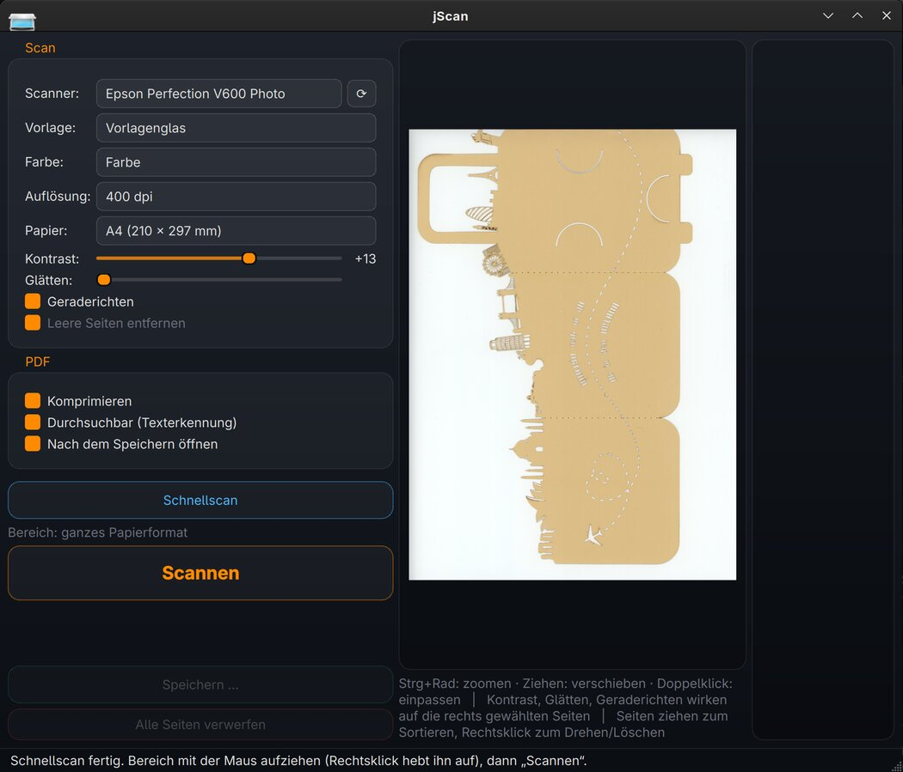

# jScan

Document scanner for the Linux desktop. Scans from USB scanners via SANE,
from the Epson Perfection V600 Photo via an own open driver and from network
scanners via eSCL (AirScan), cleans the pages up and saves them as PDF –
optionally searchable through Tesseract OCR – PNG or unprocessed TIFF.

The Sailfish OS app is [harbour-jscan](https://github.com/JimKnopfIoT/harbour-jscan);
it uses a copy of the scanner core in `src/`.

The desktop window is in German; scan and PDF messages are in English and
German.

## Features

- Sheet feeder (simplex/duplex) and flatbed, resolution per scanner.
- Own eSCL client that waits out network scanners which are briefly busy
  or drop off Wi-Fi for a moment.
- Per page after scanning: color / grayscale / black and white, contrast,
  background smoothing (removes greyish paper, uneven lighting), deskew,
  rotate, reorder, delete.
- Blank pages can be removed automatically when using the feeder.
- PDF lossless or JPEG-compressed; searchable PDF (German and English text
  recognition) with Tesseract.

## Screenshot

Main window after a quick scan with the Epson Perfection V600 Photo; drag
with the mouse to choose the scan area, then “Scannen”.

## Tested devices

| Device | Connection |
|---|---|
| Canon imageFORMULA P-215II | USB (SANE `canon_dr`) |
| Epson Perfection V600 Photo | USB (own driver, needs Epson's firmware file) |
| HP OfficeJet Pro 8130e | Network (eSCL) |

Further devices tested with the Sailfish OS app (same scanner core) are
listed in harbour-jscan's README.

Other scanners should work as long as SANE supports them or
they offer eSCL/AirScan, which most network-capable multifunction printers
of recent years do. Reports about further devices are welcome – please open
an issue with the exact model.

The Epson Perfection V600 Photo needs no vendor driver: jScan has its own
open driver for it, see below.

Notes for the Canon P-215II: the “Auto Start” switch on the back must be set
to OFF; sheets go into the feeder face down and upside down.

## Epson Perfection V600 Photo

Epson only offers a closed, x86-64-only plugin for this scanner
(`iscan-plugin-gt-x820`). jScan talks to it directly via libusb with its own
driver (`src/v600scanner.cpp`), written from USB recordings of the scanner's
normal operation, so it also works on ARM devices. It does not use SANE or
Epson's plugin.

Currently supported: flatbed, colour and grayscale, 100–6400 dpi. The
optical resolutions are 400, 800, 1600, 3200 and 6400 dpi; the others are
scanned at the next higher one and scaled down. Very high resolutions are
limited to areas of about 150 megapixels (e.g. 48 × 48 mm at 6400 dpi).
On the Linux desktop it can also scan with 16 bit per sample (“Colour,
16 bit” / “Grayscale, 16 bit”; same tone curve as 8 bit, much finer steps).
Such scans are best saved as “TIFF – unprocessed scan data”: one file per
page in full depth, only rotated, ready for photo software such as
darktable. The page adjustments (contrast, background, …) apply to PDF and
PNG only.
Not yet: the transparency unit for film.

### Firmware

The scanner loses its firmware when it is switched off; the driver uploads
it again after every power-on. The firmware belongs to Epson and is **not
included with jScan**. You need the file

    esfwA1.bin   (65 793 bytes)
    SHA-256 3fde1787469c5cc3624743da6be2671ee297d07ba3fa8439d9d9408631cd8bc3

jScan looks for it in this order and uses the first one it finds:

1. the path in the environment variable `JSCAN_V600_FIRMWARE`
2. `~/.local/share/jscan/firmware/esfwA1.bin` (per user)
3. `/usr/share/jscan/firmware/esfwA1.bin`
4. `/usr/share/iscan/esfwA1.bin` and `/usr/local/share/iscan/esfwA1.bin`
   (where Epson's own packages install it)

Where to get it:

- **From your distribution**, where available: Fedora's package
  `iscan-firmware` or the AUR package `iscan-plugin-gt-x820` on Arch Linux
  install it to `/usr/share/iscan/esfwA1.bin`; jScan then finds it without
  further steps.
- **From Epson's Linux driver download** for the Perfection V600 Photo
  (“Image Scan! for Linux”, bundle `iscan-gt-x820-bundle-2.30.4.x64.deb.tar.gz`
  or the `.rpm` variant). Nothing needs to be installed: unpack the bundle,
  then unpack the package `iscan-plugin-gt-x820` inside it
  (`.deb`: `ar x <package>.deb && tar xf data.tar.*`;
  `.rpm`: `rpm2cpio <package>.rpm | cpio -idm`). The file is
  `usr/share/iscan/esfwA1.bin`. Check it with `sha256sum esfwA1.bin`.

Copy it into place, for example:

    mkdir -p ~/.local/share/jscan/firmware
    cp esfwA1.bin ~/.local/share/jscan/firmware/

If the file is missing, jScan says so as soon as the V600 is selected and
names the expected path.

### USB access

On the Linux desktop, the user needs access to USB device 04b8:013a, e.g.
with this udev rule in `/etc/udev/rules.d/60-jscan-epson-v600.rules` (the
user must be in the group `scanner`):

    SUBSYSTEM=="usb", ATTR{idVendor}=="04b8", ATTR{idProduct}=="013a", GROUP="scanner", MODE="0660"

followed by `sudo udevadm control --reload && sudo udevadm trigger`.

If Epson's `epkowa` SANE backend is installed as well, jScan hides its entry
for the V600 and uses its own driver.

## Building

Requirements: Qt 6 (Widgets, Network, LinguistTools), SANE (`sane-backends`),
libusb 1.0, optionally Tesseract with the `deu` and `eng` language data
for searchable PDFs.

    cmake -S . -B build -DCMAKE_BUILD_TYPE=Release
    cmake --build build
    sudo cmake --install build

The user needs access to the scanner (usually via the `scanner` group or a
udev rule from the SANE package). The desktop window itself is still in
German only; the scan and PDF messages are translated.

A Windows version is planned but the scanner backend is not written yet.

## Translations

English is the source language. `translations/update.sh` collects new
strings into `translations/jscan-de.ts`; further languages can be added the
same way.

## License

jScan is released under the MIT License, see `LICENSE`.

The firmware of the Epson Perfection V600 Photo is Epson's property and is
not part of jScan.

LLM assisted development
